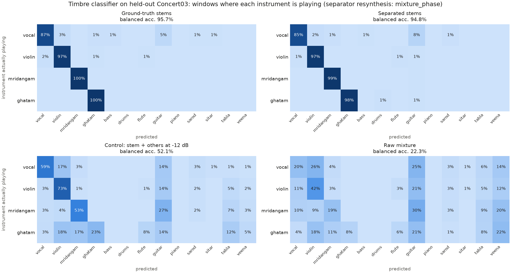
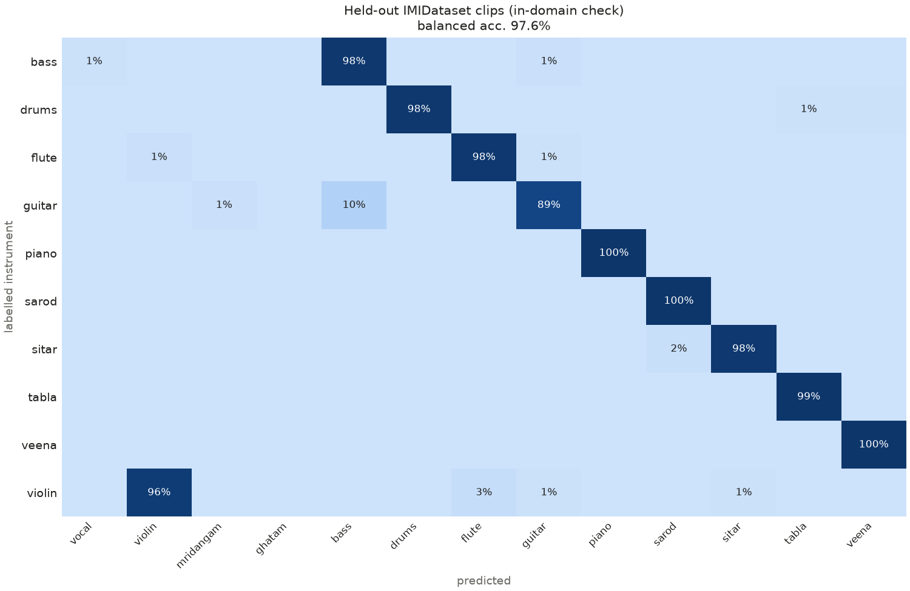

# Milestone 4: Timbre recognition and auto-tagging

**Deliverable:** an evaluation report of classification accuracy on the
separated stems, showing that cross-instrument bleed was removed.

* `classifier_report.pdf`: page 1 has the Concert03 confusion matrices, page 2
  the held-out IMIDataset matrix, page 3 the per-class table. The two `.png`
  files are pages 1 and 2.
* `classifier_eval.json`: every number below, per condition and per track.
* `checkpoint/`: `classifier.pt` (the CNN, its MFCC settings and every
  split), `history.json` and `train_classifier.log`.
* `sanidha_only/`: the same evaluation with an earlier classifier trained on
  Sanidha alone, kept for comparison (see the end of this file).
* `saraga/`: the live-bleed version of this test, on all 168 Saraga
  recordings. It has its own README.

## Method

**Features.** 1 s windows at a 0.5 s hop, 22.05 kHz. Each window is 40 MFCCs
plus deltas and delta-deltas, giving a 120 × 86 patch, with mel bands capped at
8 kHz (see the data notes below). Silent windows are dropped: below −50 dBFS,
or more than 30 dB under the recording's own loud level.

**Model.** `indian_mss/classify/model.py`: a 4-block 2-D CNN (99k parameters)
with global average pooling and per-coefficient standardization stored in the
checkpoint. Training uses class-weighted cross-entropy, an equal window budget
per class (4000), and a random ±6 dB level shift applied directly to c0, so
recording level is not a cue.

**Training data: IMIDataset plus Sanidha, 13 classes.** IMIDataset supplies
its ten classes: bass, drums, flute, guitar, piano, sarod, sitar, tabla, veena
and violin. None of them is voice, mridangam or ghatam, yet those are three of
the four stems the separator produces. Sanidha's clean close-mic stems fill
those three classes, and violin draws on both corpora. So the classifier
answers with any of 13 instruments, and a mridangam stem that "sounds like
tabla" shows up as exactly that.

| split | IMIDataset | Sanidha |
|---|---|---|
| train | 6250 clips | 27 recordings (Concert01, 02, 04, 05) |
| val (epoch selection) | 1144 clips | 4 recordings, one per training concert |
| test | **1234 clips** (in-domain check) | **all 6 of Concert03**, whole tracks, 82 min |

Best epoch: 25, validation balanced accuracy 99.0% (13 classes).

### IMIDataset as shipped, and what the loader does about it

`indian_mss/data/imi.py` handles four problems found in the download:

* **Duplicates.** `Imid-06` is a byte-identical copy of `Imid-02` (1120
  files). Four `Bass_<N>song(1).wav` files copy their originals, and six clips
  appear under two numbers. All are dropped, leaving **8628 distinct clips,
  about 13.8 h**. The proposal's figure of 33 h does not match this release.
* **Clips are consecutive excerpts.** For sitar, sarod and veena, the sample
  step across the boundary from clip N to clip N+1 is no larger than a normal
  step inside a clip, so they were cut in order from longer recordings. A
  random clip split would put neighbouring seconds of one performance in both
  train and test. Splits are therefore by block of 100 consecutive clip numbers
  (15% of each class's blocks to val, 15% to test), so leakage is limited to
  block edges.
* **Sample rate follows class.** All 1410 piano clips are 16 kHz and all
  sitar, sarod and veena clips are 48 kHz. Piano alone would have nothing above
  8 kHz, and a CNN would learn that instead of timbre. The MFCC mel bands are
  capped at 8 kHz for every class.
* **Short clips.** Violin and flute clips have a median length of 1 s. Clips
  shorter than a window are zero-padded rather than dropped.

## Test conditions

`scripts/evaluate_classifier.py` separates every Concert03 recording with the
Milestone 2 model (`../milestone_2_model/checkpoint/best.pt`) and
resynthesizes with mixture-phase ISTFT (Milestone 3). For each instrument it
then takes the windows where that instrument's ground-truth stem is playing
(vocal 6782, violin 7958, mridangam 4916, ghatam 3443) and classifies the same
windows four times:

| condition | input |
|---|---|
| reference | the clean close-mic stem: the classifier's own ceiling |
| **separated** | **the separator's stem for that instrument** |
| bleed_12db | control: the clean stem with every other instrument added 12 dB down |
| mixture | the full mix: the floor |

The control is what makes the comparison meaningful. If the classifier were
deaf to bleed, a leaky separated stem could still score like the reference.

## Results



| instrument | reference | **separated** | bleed −12 dB | mixture |
|---|---|---|---|---|
| vocal | 86.8% | **85.0%** | 59.0% | 20.1% |
| violin | 96.7% | **97.2%** | 72.9% | 42.0% |
| mridangam | 99.5% | **99.1%** | 53.2% | 18.8% |
| ghatam | 99.8% | **98.0%** | 23.5% | 8.3% |
| **balanced accuracy** | 95.7% | **94.8%** | 52.1% | 22.3% |
| mean bleed mass | 0.05 | **0.07** | 0.50 | 0.78 |

Chance is 1 in 13 (7.7%). Bleed mass is the mean probability the classifier
puts on any class other than the true one. Unlike accuracy, it does not need
the bleed to win the vote.

Balanced accuracy for each track:

| track | reference | separated | bleed −12 dB | mixture |
|---|---|---|---|---|
| 01 Vanajakshi-Varnam | 97.9% | 97.5% | 45.2% | 11.1% |
| 02 Sharanam-Bhavan | 95.5% | 94.4% | 49.1% | 17.0% |
| 03 Shambo-Sathatham | 94.8% | 94.2% | 50.3% | 19.2% |
| 04 Baaraiya-Ranga | 95.6% | 94.3% | 36.4% | 5.7% |
| 05 Ramanatham-Bhajeham | 96.1% | 95.2% | 60.1% | 32.1% |
| 06 Venkatachala-Nilayam | 95.5% | 93.9% | 43.3% | 14.0% |

**In-domain check, held-out IMIDataset clips: 97.6% balanced accuracy.**
Every class is at 95.6% or above except guitar (89.2%; 9.6% of its windows go
to bass). The classifier is sound on its training corpus, so the Concert03
numbers measure the audio, not a broken model.



## What it shows

* **Separated stems classify almost like clean ones:** 94.8% against 95.7%
  balanced accuracy, within 0.4–1.6 points on every track. Leaving the other
  instruments just 12 dB down drops the same classifier to 52.1%. As far as
  timbre is concerned, the leakage left in the separated stems is well below
  −12 dB. This is the bleed-removal result the proposal asks for.
* **The classifier does see bleed, and names it.** Accuracy falls from 95.7%
  (reference) to 52.1% (−12 dB control) to 22.3% (mixture), and bleed mass
  rises from 0.05 to 0.50 to 0.78. Ghatam is the most sensitive: at −12 dB
  bleed only 23.5% of its windows stay ghatam, while 98.0% of its separated
  windows do.
* **Dense audio is read as plucked, polyphonic instruments.** In the
  control and the mixture, the wrong answers are mostly guitar (14–30% of
  windows) and veena (up to 22% in the mix). These are the IMIDataset classes
  whose clips hold chords and overlapping notes. The separated stems hardly
  ever trigger them: vocal → guitar is 8.1% against 5.5% on clean vocal, and
  every other instrument is at 1% or less.
* **What is left, and where.** The separator's largest trace is in the vocal
  stem: 1.8 points of vocal accuracy lost, mostly to guitar (+2.6) and
  mridangam (1.4% of windows, against 0.1% clean). This matches Milestone 3, where vocal
  lost the most SDR. The ghatam stem loses 1.8 points (to drums and guitar).
  The separated violin scores marginally *above* the clean one (97.2% vs
  96.7%), within noise.
* **Vocal is the classifier's weak class even on clean audio** (86.8%, with
  5.5% to guitar and 3.3% to violin). Carnatic voice and violin follow one
  melodic line, and nothing in IMIDataset is a voice. Most of the vocal error
  is therefore the classifier's own, not the separator's.

## Compared with the Sanidha-only classifier (`sanidha_only/`)

| balanced accuracy | reference | separated | bleed −12 dB | mixture |
|---|---|---|---|---|
| Sanidha only, 4 classes | 97.9% | 95.7% | 61.3% | 35.7% |
| **IMIDataset + Sanidha, 13 classes** | 95.7% | **94.8%** | 52.1% | 22.3% |

Both classifiers give the same verdict. Separated stems sit 1–2 points under
clean ones and 40+ points above the bleed control. With 13 classes the gap
from separated to reference narrows (2.2 → 0.9 points) and the gap from
separated to control widens (34 → 43 points). There are more ways to be wrong,
so bleed is penalised harder, and the separated stems still hold up.

## Caveats

* **This is not the live-bleed test.** Sanidha's mixture is the sum of
  near-bleed-free close mics. The live version is in `saraga/`. There,
  separated stems reach 86.3% balanced accuracy (vocal, violin, mridangam)
  against 60.0% for the live close mics and 16.0% for the mixture. For vocal
  and violin the gain is bleed removal. For mridangam it is mostly a
  recording-domain effect, and ghatam cannot be tested there.
* **Concert03 is not perfectly untouched for the separator.** The separator
  never trained on it, but its `best.pt` epoch was *selected* by validation SDR
  on Concert03, which flatters the separated column slightly. The classifier
  never saw Concert03 at all.
* **Corpus is a possible shortcut.** Vocal, mridangam and ghatam come only
  from Sanidha. The classifier could partly recognise "Sanidha recording"
  rather than the instrument. The per-class budget and level augmentation
  limit this, and the mixture condition shows it does not simply map Sanidha
  audio to those three classes: it calls most mixture windows guitar, veena or
  violin. Still, the IMIDataset classes and the Sanidha-only classes are never
  tested on each other's recordings.
* **IMIDataset leakage is bounded, not zero.** Blocks of 100 clip numbers
  keep almost all neighbouring excerpts together, but a recording that crosses
  a block edge can still sit on both sides of the split.

## Regenerating

```bash
python scripts/train_classifier.py --sanidha-root data/sanidha_flat --imi-root data/IMIDataset \
    --outdir checkpoints/classifier --cache checkpoints/classifier/windows.npz
python scripts/evaluate_classifier.py --classifier checkpoints/classifier/classifier.pt \
    --separator deliverables/milestone_2_model/checkpoint/best.pt \
    --sanidha-root data/sanidha_flat --outdir deliverables/milestone_4_classifier
```

Add `--no-imi` to the first command for the Sanidha-only classifier. Settings
are in the `classifier:` block of `configs/default.yaml`.
