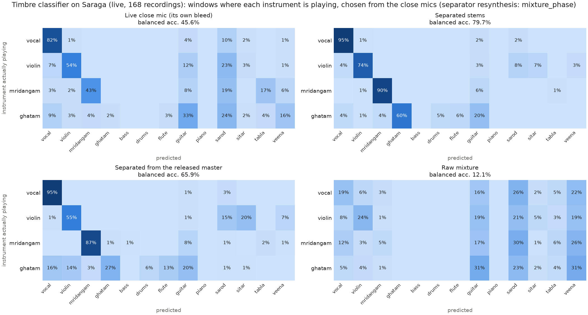

# Milestone 4 on live audio: Saraga

The Concert03 test in `../` measures bleed against a *simulated* −12 dB
control, on studio audio. This is the live version: all 168 Saraga Carnatic
multitrack recordings (19 concerts, one venue, central 60 s each, the same
excerpts as the Milestone 2 Saraga SDR evaluation). Every close mic here
carries real bleed from the rest of the ensemble.

* `classifier_saraga.json`: every number below, per condition and per track
  (`track_id` joins with `../../milestone_2_model/saraga/saraga_eval.json`),
  plus the bleed floor for each concert and mic.
* `classifier_saraga_report.pdf`: confusion matrices (page 1, also
  `classifier_saraga_report.png`) and the per-class table.
* `classifier_saraga.log`: the run's console output.

Same classifier (`../checkpoint/classifier.pt`, 13 classes), same separator
(`../../milestone_2_model/checkpoint/best.pt`, mixture-phase ISTFT). Neither
network ever trained on Saraga.

## Choosing windows without a clean reference

Sanidha's test picks the windows where the clean stem is playing. Saraga has
no clean stem, and a silent instrument's close mic still looks loud wherever
the ensemble plays. So the windows come from a **bleed-floor rule**
(`indian_mss/classify/live.py`):

1. For each mic and 1 s window, take the ratio of that mic's energy to the
   energy on all the other mics.
2. A mic's **bleed floor** is the 5th percentile of that ratio over the whole
   concert, which is where the instrument rests and its mic holds only leakage.
   The floor is pooled per concert, so an excerpt where the mridangam never
   stops does not set its own floor on the playing level.
3. A window counts as "playing" when the ratio is **≥ 10 dB above the floor**
   and the mic passes the usual silence thresholds.

Median floors across concerts: vocal −20.0, violin −17.2, mridangam −14.6,
ghatam −19.4 dB.

**Validation** (`reports/validate_live_windows.py`). Every Sanidha mic pair
was leaked through its own random room response, and the rule was scored
against the clean-stem windows. "Own < 50%" is the share of kept windows where
the instrument supplies less than half of its own mic's energy:

| bleed per mic pair | | vocal | violin | mridangam | ghatam |
|---|---|---|---|---|---|
| −20 to −8 dB | precision | 1.000 | 0.987 | 1.000 | 0.868 |
| | own < 50% | 1.3% | 3.0% | 0.3% | 30.5% |
| −14 to −2 dB | precision | 1.000 | 0.990 | 0.994 | 0.745 |
| | own < 50% | 2.7% | 3.1% | 4.8% | 72.5% |

For vocal, violin and mridangam the instrument dominates its own mic in more
than 95% of the kept windows, even under heavy bleed. **Ghatam is not
reliable:** it is quiet enough that bleed outweighs it in 30–73% of its kept
windows. The headline below is therefore over the other three. Ghatam is shown
but not interpreted.

The price is recall. Windows where an instrument plays softly under a loud
ensemble are dropped, so the scored set leans towards passages where it
stands out. That is why the mixture still gets 24% of violin windows right
(many are violin solos). Every condition is scored on the same windows, so
comparisons between them are fair. Absolute accuracies are not comparable
with Concert03's.

## Conditions

| condition | input |
|---|---|
| close_mic | the instrument's own live close mic, bleed included |
| **separated** | **the separator's stem, from the sum of the close mics** |
| separated_master | the separator's stem, from the released stereo master |
| mixture | the sum of the close mics: the floor |

The master is offset from the mics by a few milliseconds and differently
engineered, which ruins its SDR (see Milestone 2). A 1 s classification
window is unaffected, so the master can be used here.

## Results



| instrument | windows | close mic | **separated** | separated (master) | mixture |
|---|---|---|---|---|---|
| vocal | 11609 | 82.2% | **95.2%** | 95.3% | 19.1% |
| violin | 6093 | 54.3% | **73.6%** | 54.7% | 24.0% |
| mridangam | 12011 | 43.5% | **90.2%** | 86.9% | 5.0% |
| **balanced, 3 stems** | | 60.0% | **86.3%** | 79.0% | 16.0% |
| *ghatam (unreliable windows)* | *646* | *2.3%* | *59.6%* | *26.8%* | *0.2%* |
| mean bleed mass, 3 stems | | 0.42 | 0.16 | 0.24 | 0.84 |

Per track, the separated stem beats the close mic on 85% of tracks for vocal
(median +7.0 points), 85% for violin (+29.0) and 100% for mridangam (+46.3)
(tracks with ≥ 10 windows).

## What it shows

**Separated stems classify better than the live close mics did.** That is
the bleed-removal claim on real live bleed, not simulated bleed, and it holds
on most tracks. But the three instruments need different readings, because
the gap has two possible sources: bleed on the close mic, or a recording-domain
mismatch that the separator smooths over (it was trained on Sanidha, the
corpus the classifier learned vocal, mridangam and ghatam from).

`reports/saraga_close_mic_bins.py` separates them. If close-mic errors come
from bleed, close-mic accuracy should climb as the window moves further above
the bleed floor (less bleed in it). If they come from domain shift, it should
stay flat:

| close-mic accuracy, dB above floor | 10–15 | 15–20 | 20–25 | 25–30 | ≥ 30 |
|---|---|---|---|---|---|
| vocal | 72.7% | 83.6% | 91.8% | 89.0% | 92.8% |
| violin | 40.1% | 58.0% | 58.6% | 78.8% | 83.6% |
| mridangam | 34.2% | 47.3% | 48.1% | 47.5% | 49.4% |

* **Vocal and violin: the gap is bleed, and separation removes it.** Close-mic
  accuracy rises steadily with distance from the bleed floor, reaching 93% /
  84% in the cleanest windows. That is about where the separated stems sit
  overall (95% / 74%). The separator brings every window close to what the
  close mic achieves only when bleed is negligible.
* **Mridangam: mostly domain shift, not bleed.** Close-mic accuracy levels off
  at about 48% from 15 dB above the floor upwards, and its top error turns
  into **tabla**. Saraga's live mridangam (two mics summed, different placement)
  sounds partly like tabla to this classifier even when nearly bleed-free.
  Separated mridangam scores 90%, so the separator's output is more
  Sanidha-like than the input. **The +47-point mridangam gain therefore does
  not measure bleed removal**, and quoting it as such would overstate the
  result. Only the low-margin windows (34% → 47% from 10–15 to 15–20 dB) show
  a bleed effect.
* **Separating the released master works for voice and percussion, not
  violin.** Vocal is identical (95.3%) and mridangam close (86.9%), but violin
  falls back to the close-mic level (54.7%), with errors moving to sitar and
  sarod. The master's own EQ, reverb and stereo mix change the violin more
  than the other stems. This is the realistic input a listener has, so it is
  the more honest number for "separate a released recording".
* **Classifier accuracy and SDR do not track each other per track.** The
  correlation between per-track separated accuracy and SDR is near zero
  (vocal +0.02, violin +0.04, mridangam +0.10). On Saraga, SDR is scored
  against bleed-filled references, so it cannot see bleed removal, while the
  classifier can. This supports the Milestone 2 note that SDR alone
  understates live performance.
* **The errors that remain** go mostly to sarod, guitar and sitar, not to the
  other ensemble instruments: violin (separated) → sarod 8%, sitar 7%, vocal
  4%. On Concert03 too, dense or bled audio was read as these plucked,
  polyphonic IMIDataset classes. Violin is the weakest separated stem here, as
  it was in the SDR results.

## Caveats

* **One venue.** All Saraga multitracks were recorded at Arkay.
* **Ghatam is untested.** The window rule cannot isolate it (see
  validation), so this test says nothing about ghatam either way.
* **The domain explanation for mridangam is inferred**, from the flat
  accuracy curve and the shift to tabla, and has not been tested directly.
  Checking it would need a clean live mridangam recording.
* **Windows lean towards exposed passages.** See "Choosing windows" above.

## Regenerating

```bash
python scripts/evaluate_classifier_saraga.py --classifier checkpoints/classifier/classifier.pt \
    --separator deliverables/milestone_2_model/checkpoint/best.pt \
    --outdir deliverables/milestone_4_classifier/saraga        # ~1 h on an 8 GB GPU
python reports/saraga_close_mic_bins.py                        # the bleed-vs-domain check
python reports/validate_live_windows.py                        # the window-rule validation
```

Rule settings are under `classifier.live` in `configs/default.yaml`.
